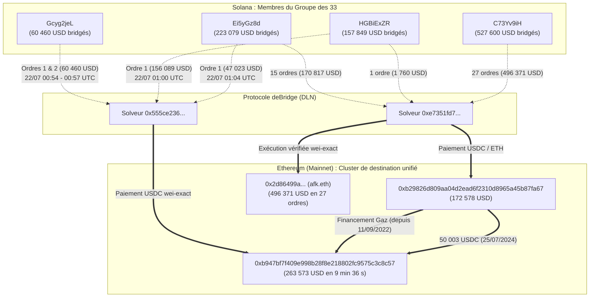
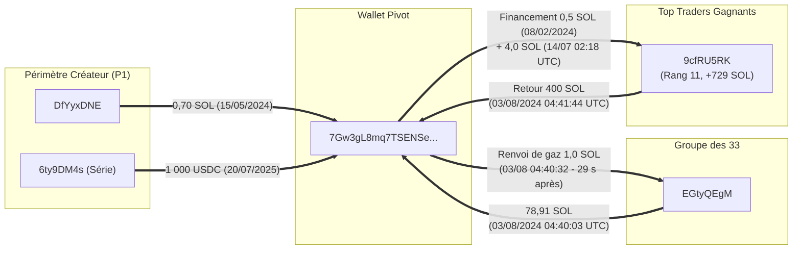
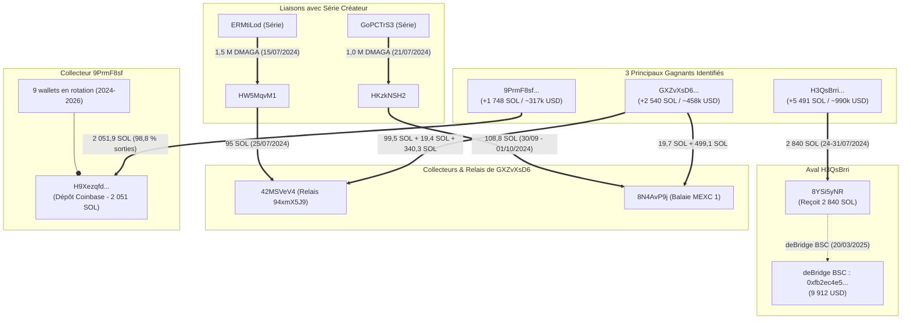

# Graphes de connectivité des flux financiers ($DMAGA)

**Date :** 05/11/2026  
**Légende des liaisons :**
* `==>` : Transfert direct de fonds / jetons sur la même chaîne
* `-.->` : Sortie inter-chaînes (deBridge / DLN)
* `--o` : Dépôt vers un compte collecteur / infrastructure partagée

---

## Graphe 1 : Reconvergence cross-chain vers Ethereum (Sorties deBridge)

Ce schéma montre comment 3 des wallets du groupe des 33 ont fait converger leurs profits en 9 minutes vers la même adresse Ethereum, et comment cette dernière est unifiée à un second compte récepteur depuis septembre 2022.

---

## Graphe 2 : Le Hub de croisement inter-périmètres `7Gw3gL8m`

Ce schéma détaille l'articulation entre le Périmètre Créateur (P1), le Groupe des 33 et le Top Trader n° 11 via le wallet pivot `7Gw3gL8m`.

---

## Graphe 3 : Les 3 plus gros gagnants et leurs points de convergence

