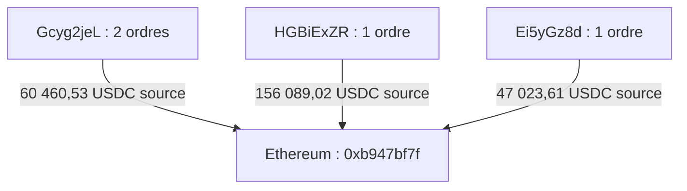
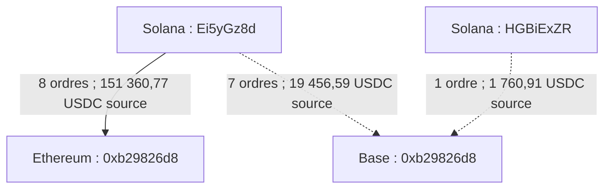
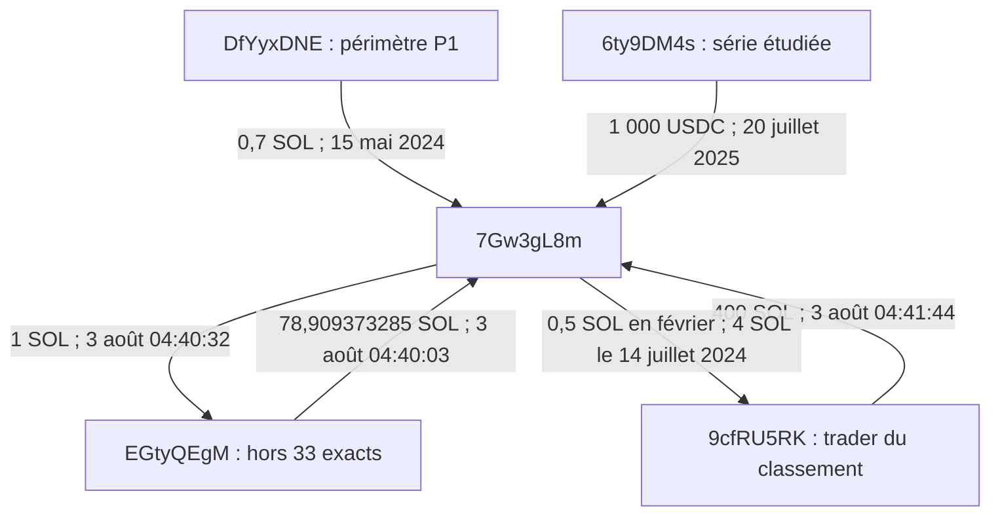

# Graphes des ordres et jonctions documentés ($DMAGA)

**Révision :** 5 novembre 2026. Ces graphes résument les archives citées dans [la table des liens](TABLE_NEW_LINKS.md). Les adresses complètes et les signatures s'y trouvent. Les montants de bridge affichés sur les arêtes sont les **USDC source, frais proportionnels inclus**, pas nécessairement les montants reçus. Les graphes ne regroupent pas les wallets par propriétaire.

## 1. Quatre ordres, trois makers, un destinataire Ethereum

Le 22 juillet 2024, la fenêtre des ordres source dure **9 min 36 s**. Les trois makers appartiennent à la composante exacte de 33 wallets. Les quatre paiements correspondants sont rapprochés dans I21 avec leurs hashes.

Total source exact : **263 573,151396 USDC**. Total de paiements imprimé dans [I21](evidence/i21_evm_fill.txt) : **263 320,105094 USDC**, après 35 à 53 secondes. Les flèches résument des ordres et leurs rapprochements archivés ; elles ne décrivent pas un transfert natif direct entre les deux chaînes.

## 2. Une même représentation d'adresse, deux chaînes distinctes

Les 16 ordres nommant `0xb29826d809aa04d2ead6f2310d8965a45b87fa67` doivent conserver leur chaîne de destination. Les liens pointillés ci-dessous représentent des **arrivées non vérifiées**.

[I22](evidence/i22_evm_rest.txt) rapporte les huit rapprochements Ethereum, sans imprimer les hashes. Les huit paiements Base restent à vérifier. Les deux lignes Base totalisent **21 217,495586 USDC source** avant arrondi.

Le même journal rapporte des transferts Ethereum entre `0xb29826d8` et `0xb947bf7f` depuis 2022. Cette relation historique doit être documentée par les reçus manquants ; elle ne permet pas d'unifier les makers Solana sous une identité commune.

## 3. 7Gw3 : jonctions de périodes et de populations différentes

`EGtyQEgM` appartient à la salve du 23 juillet étudiée dans le périmètre étendu ; il est **absent des 33 exacts**. Les flèches suivantes sont des transferts Solana rapportés dans l'audit I. Elles ne déterminent pas la fonction économique du wallet central.

Les trois transferts du 3 août 2024 se suivent en **29 s**, puis **72 s**. Les versements de mai 2024 et juillet 2025 sont espacés ; le graphe ne les présente pas comme une opération simultanée. Les historiques de `7Gw3gL8m` et `9cfRU5RK` cités par l'audit sont partiels. La relation avec les populations P1 et série n'établit pas un contrôle commun par le créateur.

## Autres routes conservées sous forme de tables

| Route | Résultat documenté | Limite déterminante |
|---|---|---|
| `C73Yv9iH` → `0x2d86499a` sur Ethereum | 27 ordres, 496 371,59 USDC source, hashes dans I21 | S'étale jusqu'au 9 juin 2025 ; identité du bénéficiaire non établie |
| `H3QsBr` → `8YSi5yNR`, puis ordres vers BSC | 2 840 SOL rapportés en juillet 2024 ; 2 ordres en mars 2025, 9 912,83 USDC source | Paiements BSC et continuité de ces fonds précis non vérifiés |
| Série → `HW5MqvM1` / `HKzkNSH2` → dépôts également utilisés par GXZvX | Transferts distincts, référencés dans l'audit G | Contreparties partagées et activité intermédiaire ; pas d'attribution commune à GXZvX |

Voir [les références transactionnelles](TABLE_NEW_LINKS.md) et [les règles de comptage](TABLE_DEBRIDGE_ORDERS.md).
