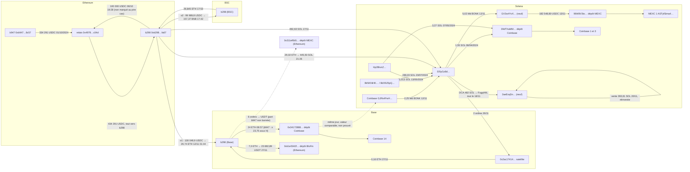

# Graphe des principaux flux (06/11/2026, version auditée)

Flèches pleines : transactions relues sur la chaîne (deBridge relié par orderId recalculé). Pointillés : relation EXPLORATORY ou mélange non borné. Heures UTC.

Lecture de la frontière (`FINDINGS.md` §3) : o1 et o2 portent ensemble au moins 100 028,64 USDC de b947. La répartition entre la branche Coinbase et la branche MEXC dépend de la règle d'allocation au relais.
