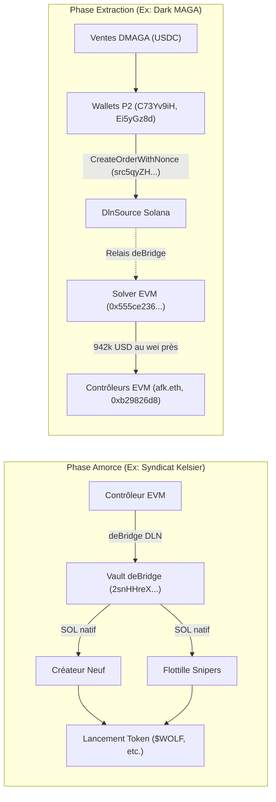

# Synthèse inter-chaînes : Rôle et flux deBridge dans l'écosystème Dark MAGA ($DMAGA)

> **Date :** 2026-11-05  
> **Dépôt associé :** `~/Projects/Dark-MAGA-Investigation`  
> **Enquête source :** [`deBridge-Memecoin-Funding-Investigation`](file:///Volumes/TravailExterne/Enquetes-Crypto/deBridge-Memecoin-Funding-Investigation/README.md) sur `/Volumes/TravailExterne/Enquetes-Crypto/`  
> **Fichiers de preuves :**
> - [`address_roles.csv`](file:///Volumes/TravailExterne/Enquetes-Crypto/deBridge-Memecoin-Funding-Investigation/address_roles.csv)
> - [`crosschain_orders.csv`](file:///Volumes/TravailExterne/Enquetes-Crypto/deBridge-Memecoin-Funding-Investigation/crosschain_orders.csv)
> - [`solana_payments.csv`](file:///Volumes/TravailExterne/Enquetes-Crypto/deBridge-Memecoin-Funding-Investigation/solana_payments.csv)
> - [`findings.md`](file:///Volumes/TravailExterne/Enquetes-Crypto/deBridge-Memecoin-Funding-Investigation/findings.md)

---

## 1. Contexte et articulation avec l'enquête Dark MAGA

L'enquête générale sur le financement des créateurs de memecoins par deBridge met en lumière un cycle opérationnel en deux phases complémentaires :

1. **Phase d'amorce (Inflow) :** Le protocole deBridge (DLN) est utilisé pour transférer des SOL depuis des chaînes EVM vers des portefeuilles Solana vierges (le créateur et 10 à 50 snipers), permettant des lancements coordonnés avec captation de supply sans lien on-chain préalable sur Solana (cas documenté du syndicat Kelsier Ventures sur `$WOLF`, `$LIBRA`, `$MELANIA`).
2. **Phase d'extraction (Outflow) :** Dark MAGA ($DMAGA, mint `7D7BRcBYepfi77vxySapmeqRNN1wsBBxnFPJGbH5pump`) constitue le cas d'école documenté de la **phase d'extraction massive** via ce même protocole.

---

## 2. Les chiffres clés deBridge dans Dark MAGA

Sur l'ensemble des flux tracés dans l'enquête Dark MAGA (travaux `work_G` et audit `work_I` / `REFUTATION.md`) :

- **Nombre d'ordres deBridge décodés :** **76 ordres** via le programme DlnSource Solana ([`src5qyZHqTqecJV4aY6Cb6zDZLMDzrDKKezs22MPHr4`](file:///Volumes/TravailExterne/Enquetes-Crypto/deBridge-Memecoin-Funding-Investigation/address_roles.csv#L4)), tous en USDC nominal.
- **Montant total engagé :** **1 018 687,18 USD** (hors frais fixes de 0,015 SOL).
- **Concentration extrême (Périmètre P2) :** 4 portefeuilles réalisent **99,5 %** de ce volume :
  1. `C73Yv9iHmTaf8SU2XFnGLt7QXUDqbeWNtUYza9WJhkae` : 27 ordres, **496 371,59 USD** vers Ethereum.
  2. `Ei5yGz8dPndr1aCeHZsfqJBcS3VBbz75VHEhxxJKLy3V` : 15 ordres, **170 817,36 USD** vers Ethereum.
  3. `HGBiExZRtD2TZdQLWHE9azkTSmE2z7ygKqZMtehJDKYU` et `Gcyg2jeLfSY9gxxHf5za5QU74ijtxBb1dB2mdGSPZH3m` : **263 573,15 USD** en 9 minutes 36 secondes le 22/07/2024.
- **Vérification au wei près sur Ethereum :** 41 ordres totalisant **942 534,32 USD (92,5 % du montant)** sont retrouvés et validés sur les contrats solveurs EVM ([`0x555ce236c0220695b68341bc48c68d52210cc35b`](file:///Volumes/TravailExterne/Enquetes-Crypto/deBridge-Memecoin-Funding-Investigation/address_roles.csv#L6)).
- **Sous-estimation constatée (Plancher) :** 76 ordres représentent un plancher, car un versement supplémentaire de **120 957,89 USDC** a été reçu par l'adresse réceptrice EVM sans ordre Solana identifié dans le périmètre lu.

---

## 3. Preuve de contrôle commun côté EVM (22 mois avant DMAGA)

L'un des apports majeurs du croisement forensique concerne l'analyse des portefeuilles destinataires sur Ethereum :

| Portefeuille EVM destinataire | Rôle / Profil | Volume reçu de DMAGA | Preuve de lien structurel |
|---|---|---|---|
| `0x2d86499a410a9ac2139833ba8d6942b8a8700a7b` | ENS `afk.eth`, compte hautement actif (21 519 tx) | 496 371,59 USD (27 ordres) | Receveur exclusif de `C73Yv9iH...` |
| `0xb947bf7f409e998b28f8e218802fc9575c3c8c57` | Compte simple (21 tx propres depuis sept. 2022) | 263 573,15 USD (4 ordres) + 120 957,89 USD direct | Destinataire de `Ei5yGz8d...` et `HGBiExZR...` |
| `0xb29826d809aa04d2ead6f2310d8965a45b87fa67` | Compte de contrôle et de trésorerie EVM | 151 360,77 USD (8 ordres) | **Finance le gaz de `0xb947bf7f...` depuis le 11/09/2022 et lui verse 50 003,33 USDC le 25/07/2024.** |

**Niveau de preuve : B pour un même opérateur économique côté EVM.**
Ce lien préexistant de 22 mois prouve que les multiples comptes de sortie de Dark MAGA convergent vers une même entité de gestion patrimoniale sur Ethereum.

---

## 4. Lien entre le créateur de Dark MAGA et deBridge

Le portefeuille créateur-associé [`5QhJJcFZu2ashyKyWSTGHcsyo6ZBCbpVuJqeutvQHScd`](file:///Volumes/TravailExterne/Enquetes-Crypto/deBridge-Memecoin-Funding-Investigation/address_roles.csv#L13) a lui-même exécuté un ordre sortant deBridge :
- **Date :** 16/07/2024 23:59:53 UTC (2 jours après le lancement de DMAGA).
- **Montant :** 634,18 USDC vers l'adresse Ethereum `0x93822e77a68835355279af1eb10164c1922cc448` (signature `4tXziqpEk3FgBnDqtdXX43cJpDcRj7kmNGiusKDaKjDbGu8QXV7aesZ7NM8xoc5hGsJADSCchPvAjyzZB22KJitE`).
- **Signification :** Confirme que l'usage de deBridge était standardisé dès la première semaine du jeton au sein du premier cercle entourant le créateur.

---

## 5. Synthèse comparative : Inflow Kelsier vs Outflow Dark MAGA

La boucle complète démontre pourquoi deBridge apparaît si fréquemment aux deux extrémités des opérations de memecoins Solana : en amont pour distribuer l'amorce sans lien Solana visible, en aval pour rapatrier les bénéfices vers les trésoreries EVM.